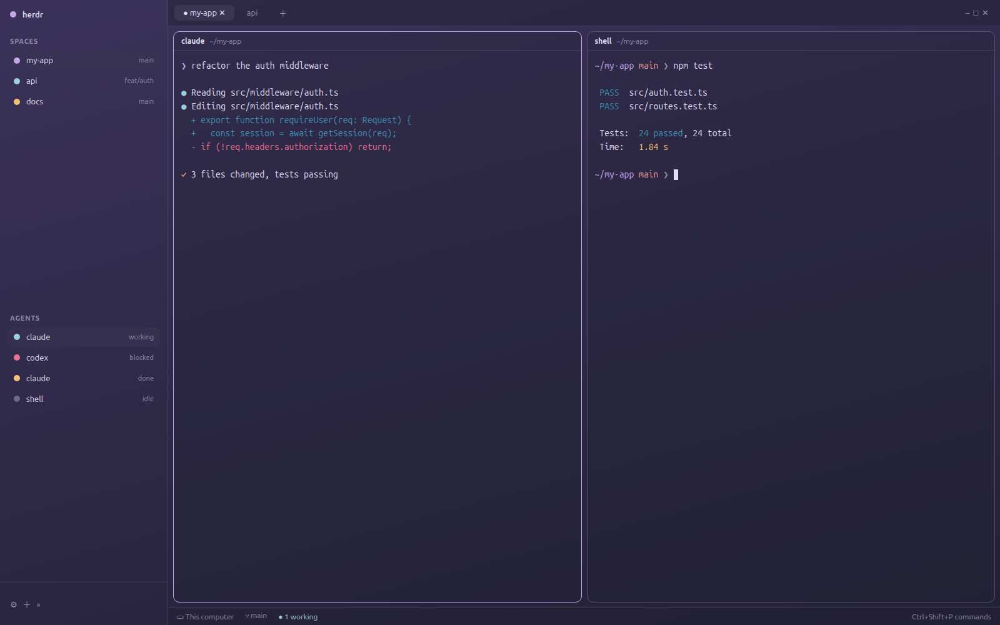

# Jepa — a Herdr layout

A Rosé Pine Moon layout for [Herdr](https://herdr.dev): translucent sidebar,
pill tabs, rounded pane cards over a soft purple gradient.



## Install

Copy the layout and its theme into your Herdr home and switch to it:

```sh
git clone https://github.com/Ol11veira/herdr-layout-jepa
cp herdr-layout-jepa/layouts/jepa.json ~/.config/herdr-app/layouts/
cp herdr-layout-jepa/themes/jepa.json  ~/.config/herdr-app/themes/
herdr-app do layout.switch '{"name":"jepa"}'
```

`ctrl-shift-l` switches back to your previous layout. If you already have a
layout or theme called `jepa`, rename these files (and `"theme"` in the
layout) before copying.

Want your own wallpaper behind it? See **Watch out** in [RECIPE.md](RECIPE.md).

## Credits

Colors from [Rosé Pine](https://rosepinetheme.com) (Moon variant, MIT).
Fonts: Ubuntu Sans and Ubuntu Sans Mono.
