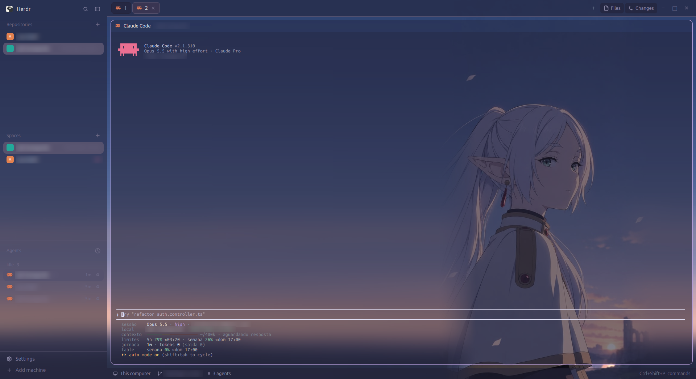
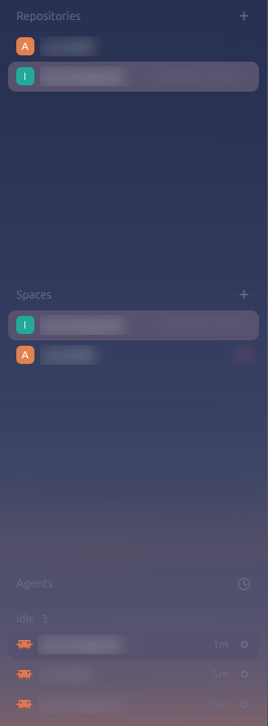
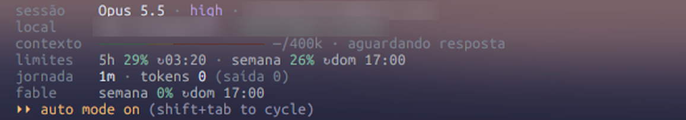

# Jepa — a Herdr layout

A Rosé Pine Moon layout for [Herdr](https://herdr.dev): translucent sidebar,
pill tabs, rounded pane cards over a soft purple gradient, and a
Repositories list that gives each repo its own space with Claude in it.
Comes with a matching Frieren status line for Claude Code.



*Screenshots use the optional Frieren wallpaper; the account email and repo
and branch names are blurred.*

## Install

Copy the layout and its theme into your Herdr home and switch to it:

```sh
git clone https://github.com/Ol11veira/herdr-layout-jepa
cp herdr-layout-jepa/layouts/jepa.json ~/.config/herdr-app/layouts/
cp herdr-layout-jepa/themes/jepa.json  ~/.config/herdr-app/themes/
cp -r herdr-layout-jepa/mods/repositories ~/.config/herdr-app/mods/
herdr-app do layout.switch '{"name":"jepa"}'
```

`ctrl-shift-l` switches back to your previous layout. If you already have a
layout, theme or mod with these names, rename them (and `"theme"` in the
layout) before copying.

### Frieren wallpaper (optional)

The layout ships with a gradient. For the wallpaper in the screenshots:

```sh
cp herdr-layout-jepa/backgrounds/frieren.jpg ~/.config/herdr-app/backgrounds/
```

then replace the root `background` in `layouts/jepa.json` with
`{ "image": "backgrounds/frieren.jpg", "fit": "cover" }`. See **Watch out** in
[RECIPE.md](RECIPE.md) for opacity on bright images.

## Repositories



A list of the repos you work on, above Spaces. Click one to go to its space,
or to make one named after the repo, in its folder, running `claude`: one
Claude per repo. `+` adds a git repo; right-click opens a second Claude tab or
removes it from the list. Details in [RECIPE.md](RECIPE.md).

## Claude Code status line



One line per section, label on the left:

| Line | Shows |
|---|---|
| `sessão` | model, effort, session name, the logged-in account's email |
| `local` | repo, branch, worktree |
| `contexto` | bar up to the auto-compact window, colored by zone: smart, atenção, dumb |
| `limites` | 5-hour, weekly and spend plan limits, with reset times |
| `jornada` | session time, tokens (cache, output, agents), lines +/−, cost without a plan |
| `fable` | Fable tokens this session and Fable's weekly limit |

Install (Node 18+):

```sh
cp herdr-layout-jepa/claude/frieren-statusline.js ~/.claude/
```

and merge `claude/settings.statusLine.json` into `~/.claude/settings.json`.
Check it with `echo '{}' | node ~/.claude/frieren-statusline.js`.

- The email is read from `oauthAccount.emailAddress` in `~/.claude.json`, so it
  follows the account you are logged in with.
- Zones default to smart below 120k and dumb from 180k; change them in
  `~/.claude/context-zones.json`: `{"smartUntil":"120k","dumbFrom":"180k"}`.
- Fable's weekly limit is not in the status line payload. A background copy of
  the script reads it from `/api/oauth/usage` (what `/usage` uses) at most every
  2 minutes and caches it in `~/.claude/state/statusline-usage.json`. That
  endpoint is internal: if it changes, only that number goes away. With an API
  key login the line doesn't show.
- **macOS:** the OAuth token is in the Keychain, not
  `~/.claude/.credentials.json`. In `fetchUsage`, read it with
  `security find-generic-password -s "Claude Code-credentials" -w`; in
  `refreshUsage`, also accept `process.platform === "darwin"`.

## Credits

Colors from [Rosé Pine](https://rosepinetheme.com) (Moon variant, MIT).
Fonts: Ubuntu Sans and Ubuntu Sans Mono. Frieren is from *Frieren: Beyond
Journey's End* (Kanehito Yamada, Tsukasa Abe); the wallpaper is not covered by
this repo's license.
