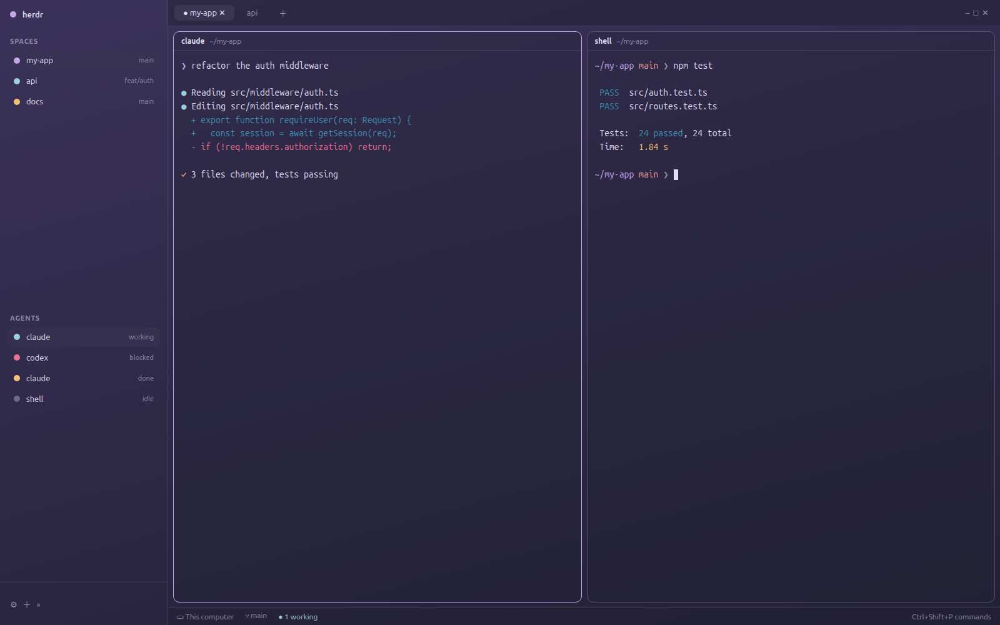

# Jepa

A calm Rosé Pine Moon workspace: a translucent sidebar with repositories, spaces
and agents on the left, pill tabs on top, every pane a rounded card with a
header, all floating over a soft purple gradient (or your own wallpaper).
Terminals use the full Rosé Pine Moon palette, with iris purple as the accent,
and Ubuntu Sans / Ubuntu Sans Mono for type.

## What you see

Left to right:

- **Sidebar**, 268px, transparent (`#00000000`), not resizable by drag,
  min 44px / max 480px. Top to bottom:
  - Brand bar, 46px (`workspace-chrome`); dragging it moves the window.
  - Repositories, Spaces and Agents lists, sharing the rest equally (weight 1
    each, min 90px).
  - Footer, 69px (`workspace-chrome` with `footer: true`).
- **Work area**, the rest of the width:
  - Tab bar, 42px (`tabs`); dragging it moves the window. There is no system
    title bar (`titlebar: "none"`), so the window buttons live here.
  - Body row, 8px padding and 8px gap:
    - The active tab's panes. Each pane is a card: radius 10, 1px `border`
      (`#56526e`), 1px iris border (`#c4a7e7`) when focused, 8px between
      panes, a 30px `pane` header always on top, transparent background. A
      lone pane is framed too.
    - Files / Changes panel, 368px (280–900px), hidden until opened from the
      tab bar; a stack of `files` and `changes`, Files active.
  - Status bar, 28px (`workspace-status`).
- **Background:** a 165° gradient from `#4b3f72` to `#232136`, under a
  `#23213666` veil; chrome is `#2321368c`. Terminals are 35% opaque
  (`terminal_opacity: 0.35`) so the background shows through, with 14px × 12px
  padding.
- **Type:** terminals in Ubuntu Sans Mono, panels in Ubuntu Sans.
- **Colors** (`themes/jepa.json`, Rosé Pine Moon): background `#232136`,
  text `#e0def4`, surface `#2a273f`, raised `#393552`, hover `#44415a`,
  border/selected `#56526e`, muted `#908caa`, dim `#6e6a86`, accent iris
  `#c4a7e7`, solid rose `#ea9a97`.

## How it behaves

- **Repositories** (`mods/repositories`) is a list you keep: `+` picks a
  folder (only a git repo is taken), right-click offers **Nova tab com
  Claude** and **Remover da lista**. Clicking a repo selects the space
  working in it, or makes one named after the repo, in its folder, running
  `claude`: one Claude per repo. Each row shows that space's color, branch
  (not main/master) and agent status; a repo with no space is dimmed. The
  list is kept in shared state (`shared.json`, key `repositories`).

- Agent status colors: **working** foam `#9ccfd8`, **blocked** love
  `#eb6f92`, **done** gold `#f6c177`, **idle** `#6e6a86`.
- The focused pane's border turns iris; the others stay `#56526e`.
- `ctrl-shift-b` folds the sidebar to a compact rail; `ctrl-shift-l` switches
  to another layout.
- Files and Changes open from the tab bar and are remembered per space.
- Panes can be dragged by the top-center grip; boundaries inside the work
  body can be resized, the sidebar edge and outer column cannot.

## Built from

- `layouts/jepa.json`: root `row` → `sidebar` (`column`: `brand`,
  `sidebar-lists` (`repositories`, `spaces`, `agents`), `sidebar-footer`) and `work`
  (`column`: `tabs`, `work-body` (`row`: `main` tab block, `panel` →
  `panel-body` stack of `files` / `changes`), `status`).
- Root look: `theme: "jepa"`, `colors: {chrome, background}`, `font`,
  `ui_font`, `terminal_padding`, `terminal_opacity`, `divider`,
  `background` gradient, `titlebar: "none"`, `traffic_lights: [12, 16]`.
- `themes/jepa.json`: the theme, named like the layout so it belongs to it.
- `mods/repositories`: the one custom mod. It runs `git rev-parse` on the
  folder you add and starts `claude` in new repo spaces; no network.
- Shipped mods: `workspace-chrome`, `spaces`, `agents`, `tabs`, `pane`,
  `files`, `changes`, `workspace-status`.

## Watch out

- **Copy `mods/repositories` too**, or the top of the sidebar stays empty.

- **Copy `themes/jepa.json` too.** It is not under `mods/` or `layouts/`, but
  without it the layout has no theme and falls back to the default colors.
- **Your own wallpaper:** put an image in `~/.config/herdr-app/backgrounds/`
  and replace the root `background` with
  `{ "image": "backgrounds/<file>", "fit": "cover" }`. A bright image needs a
  higher `terminal_opacity` (around 0.8) to keep text readable.
- Ubuntu Sans / Ubuntu Sans Mono come with Ubuntu. Elsewhere, install them or
  the terminal falls back to JetBrains Mono.
- `preview.png` is an illustration of the layout with sample content, not a
  screenshot.

## Done when

- `layout.switch {"name":"jepa"}` shows the layout and `herdr-app status`
  lists no errors.
- The sidebar shows spaces and agents over the gradient, the tab bar is on
  top, the status bar at the bottom.
- Terminals use the Rosé Pine Moon colors (e.g. `printf '\e[35mx'` prints
  iris `#c4a7e7`) and Ubuntu Sans Mono.
- Splitting a pane shows two cards 8px apart; the focused one has an iris
  border.
- Files and Changes open from the tab bar in a 368px panel on the right.
- `herdr-app check ~/.config/herdr-app/mods/repositories` passes; adding a
  repo with `+` lists it, and clicking it opens a space running `claude`.
